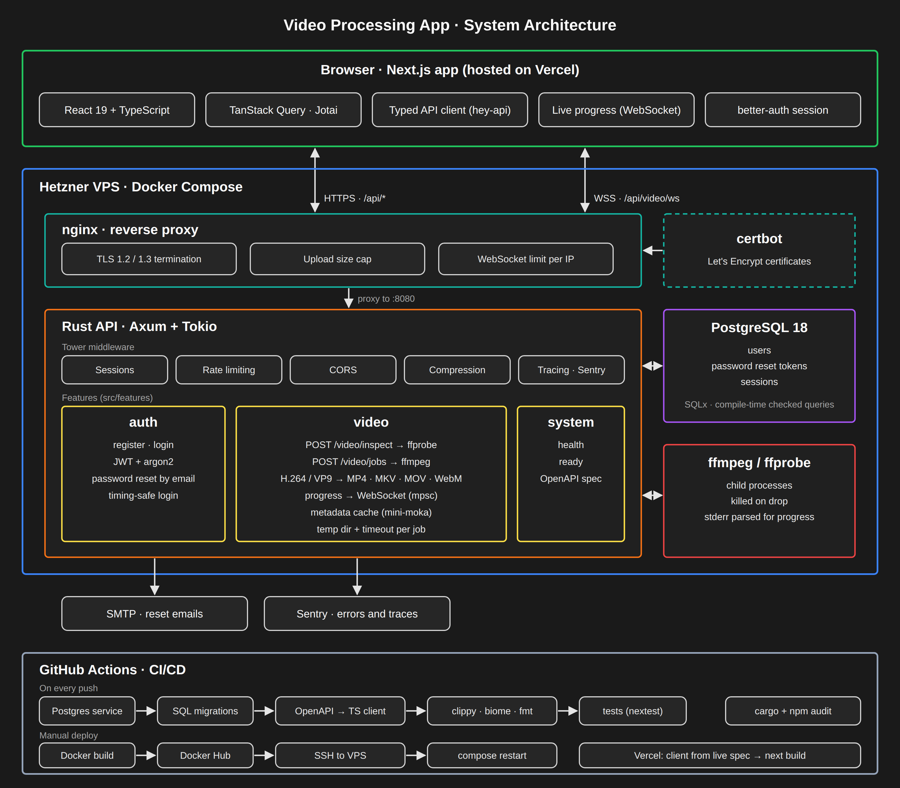

<div style="display: flex; flex-direction: column; justify-content: center; align-items: center;" align="center">
    <h1><code>Video processing app</code></h1>
    <h4>Built with <a href="https://rust-lang.org/">🦀</a><a href="https://react.dev">⚛️</a></h4>
</div>


[](https://github.com/arthurhovhannisyan31/video_processing_app/actions/workflows/code-validation.yml)
[](https://github.com/arthurhovhannisyan31/video_processing_app/actions/workflows/packages-validation.yml)

**Live demo:** https://www.videoprocessing.app/video

## Overview

A full-stack web app for inspecting and converting video files. Upload a video, see its metadata, pick an output format
and quality, and watch the job progress live while `ffmpeg` processes it on the server.

It's a monorepo with a Rust API server and a Next.js web client:

- **[`modules/backend`](modules/backend/README.md)**: Rust/Axum API. Auth and password reset, video inspect and
  process endpoints, WebSocket progress updates, PostgreSQL storage.
- **[`modules/frontend`](modules/frontend/README.md)**: Next.js/React web client. Upload UI, auth, live job progress.

## Features

- **Inspect:** upload a video and read its streams, codecs, duration and size via `ffprobe`
- **Process:** compress or convert with H.264 or VP9, output to MP4, MKV, MOV or WebM, with preset and quality options
- **Live progress:** job progress is parsed from `ffmpeg` output and pushed to the browser over a WebSocket
- **Accounts:** sign up, sign in, and reset a forgotten password by email

## Architecture



<sub>Source: [`static/images/system-architecture.svg`](static/images/system-architecture.svg)</sub>

### Request flow

1. The browser sends requests to `api.videoprocessing.app`. nginx terminates TLS (Let's Encrypt certificates renewed by
   certbot) and proxies `/api/*` to the Rust server.
2. `POST /api/video/inspect` writes the upload to a per-request temp dir, runs `ffprobe` and caches the metadata in
   memory (`mini-moka`), keyed by file name and session.
3. The browser opens a WebSocket at `/api/video/ws`. The session cookie links this socket to the user's jobs.
4. `POST /api/video/jobs` runs `ffmpeg` as a child process with a timeout. A Tokio task parses its stderr and sends
   progress through an `mpsc` channel to the session's WebSocket. When the job finishes, the processed file is streamed
   back in the response.

### Design decisions

- **OpenAPI is the API contract.** Handlers are annotated with `utoipa`, a small binary writes `openapi.json`, and
  `hey-api` generates a typed TypeScript client from it. Changing a Rust DTO breaks the frontend build until the client
  is regenerated, so the two sides can't drift apart.
- **Feature-based backend layout.** Each feature in `src/features/{auth,system,video}` owns its routes, DTOs, service,
  repository and state. Shared concerns live in `src/core`.
- **One error boundary.** Domain and server errors convert into a single `ApplicationError`, which is the only type
  that maps to an HTTP status and a `{ "message": ... }` body.
- **Compile-time checked SQL.** Queries use SQLx macros. Unchecked `sqlx::query` calls are banned in `clippy.toml`, and
  CI/Docker builds run in offline mode against the committed `.sqlx/` cache.
- **FFmpeg as a process, not bindings.** `ffmpeg`/`ffprobe` run through `tokio::process` with timeouts and
  `kill_on_drop`, so a stuck or abandoned job can't hang the server or leak processes.

### Security and limits

- Per-IP rate limiting on auth and video routes with `tower_governor` (production only). A background thread clears
  stale limiter entries.
- nginx caps the upload size and the number of WebSocket connections per IP.
- Passwords are hashed with argon2. Login checks a dummy hash when the user doesn't exist, so response time doesn't
  reveal which emails are registered.
- Upload filenames are reduced to their base name, so a name like `../../etc/passwd` can't escape the temp dir.
- Password reset tokens are stored hashed, expire, and invalidate older JWTs once used.
- Errors and traces are reported to Sentry from both the backend and the frontend.

## Tech stack

|          |                                                                                                        |
|----------|--------------------------------------------------------------------------------------------------------|
| Backend  | Rust, Axum, Tokio, SQLx/PostgreSQL, JWT + argon2, `ffmpeg`/`ffprobe`, utoipa (OpenAPI), mini-moka      |
| Frontend | Next.js 16, React 19, TypeScript, Tailwind CSS, shadcn/ui, TanStack Query, Jotai, better-auth, hey-api |
| Infra    | Hetzner VPS, Docker Compose, nginx, certbot, Vercel (frontend), Docker Hub, GitHub Actions, Sentry     |
| Testing  | cargo-nextest, axum-test, proptest, per-test Postgres databases, sample media fixtures                 |

## Repository layout

```
.
├── modules/
│   ├── backend/     # Rust API server (see modules/backend/README.md)
│   └── frontend/    # Next.js web client (see modules/frontend/README.md)
├── configs/         # shared scripts, docker files, nginx configs, git hooks
├── static/images/   # architecture diagram (SVG source + PNG)
├── .github/         # CI/CD workflows and composite actions
├── docker-compose.dev.yml
├── docker-compose.prod.yml
└── Makefile         # convenience commands spanning both modules
```

## Prerequisites

- Rust (stable, edition 2024), [`cargo-nextest`](https://nexte.st/), [
  `sqlx-cli`](https://github.com/launchbadge/sqlx/tree/main/sqlx-cli). See [
  `modules/backend/README.md`](modules/backend/README.md)
- Node.js `^24` and Yarn 4 (Berry). See [`modules/frontend/README.md`](modules/frontend/README.md)
- PostgreSQL
- `ffmpeg` / `ffprobe` on `PATH`
- Docker + Docker Compose (optional, for containerized dev/prod)

## Getting started

### 1. Manual setup

1.1 Copy the env templates and fill in the values:

```sh
cp .env.template .env                                   # backend, local `cargo run`
cp .env.template .env.container                         # backend, Docker Compose
cp modules/frontend/.env.template modules/frontend/.env # frontend
```

The backend loads `.env` itself unless `CONTAINER=true`; Docker Compose injects `.env.container`.

1.2 One-time setup (git hooks, DB query cache, API client generation):

```sh
make prepare
```

1.3 Run each module in its own terminal:

```sh
make backend    # cd modules/backend && cargo run
make frontend   # cd modules/frontend && yarn dev
```

### 2. Docker Compose

You can run the backend services with Docker Compose:

```sh
docker compose -f docker-compose.dev.yml --env-file .env.container up --build
```

This starts Postgres, the backend, [Mailpit](https://mailpit.axllent.org/) (catches password reset emails, web UI at
http://localhost:8025) and an nginx reverse proxy on port `8080` (dev config in [`configs/nginx`](configs/nginx)).
The frontend is not part of the compose setup; run it with `make frontend`.

`docker-compose.prod.yml` runs the published backend image (`IMAGE_TAG`) with Postgres, nginx and certbot.

## Common commands (Makefile)

Run from the repo root; each target delegates into the relevant module.

| Command                             | Description                                                                     |
|-------------------------------------|---------------------------------------------------------------------------------|
| `make prepare`                      | install git hooks, prepare SQLx offline cache, generate the frontend API client |
| `make backend` / `make frontend`    | run the backend / frontend dev servers                                          |
| `make check`                        | lint both modules (`cargo clippy`, `yarn check`)                                |
| `make format` / `make format-check` | format both modules / verify formatting in CI                                   |
| `make test`                         | run backend tests (`cargo nextest run`, needs Postgres + `ffmpeg`)              |
| `make audit`                        | dependency vulnerability audits for both modules                                |
| `make generate-openapi`             | regenerate `openapi.json` from the backend                                      |
| `make prepare-frontend-local`       | regenerate the frontend's typed API client from the local backend schema        |

## Git hooks

`make prepare` installs hooks from [`configs/git/hooks`](configs/git/hooks):

- **pre-commit**: `make check`, `make format`
- **pre-push**: `make generate-openapi`, `make prepare-frontend-local`, `make check`, `make format-check`, `make test`,
  `make audit`

## CI/CD



GitHub Actions workflows in [`.github/workflows`](.github/workflows):

- **code-validation**: on every push, starts a Postgres service, runs migrations, generates the OpenAPI client, then
  lints, format-checks and tests both modules
- **packages-validation**: `cargo audit` and `yarn npm audit`
- **cleanup-caches**: clears GitHub Actions caches for closed branches
- **server-build-and-deploy**: manual. Builds the backend Docker image, pushes it to Docker Hub, uploads compose and
  nginx configs to the VPS over SSH, writes the production env file and restarts the containers. It can skip the build
  and redeploy the current tag.
- **release**: manual. Merges `develop` into `main` and creates a semantic versioned release

The frontend is deployed by Vercel. Its build ([`configs/scripts/build-fe.sh`](configs/scripts/build-fe.sh)) generates
the API client from the live OpenAPI spec, then runs `next build`.

## License

Dual-licensed under [MIT](LICENSE_MIT) or [Apache-2.0](LICENSE_APACHE), at your option.
